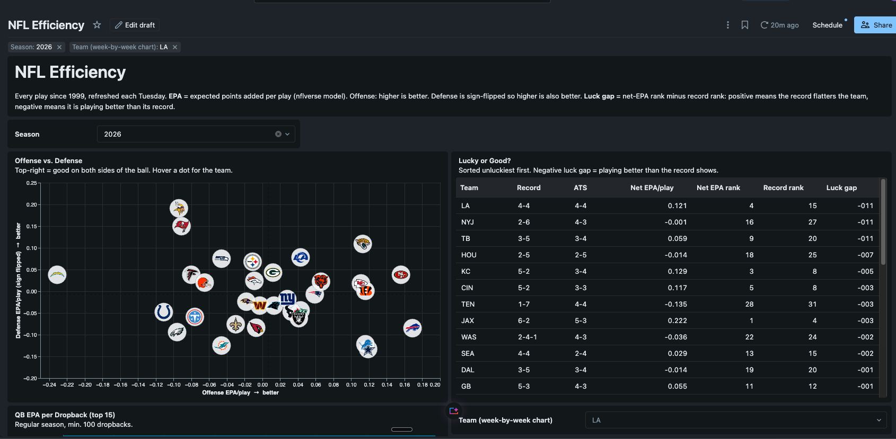
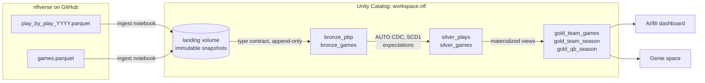
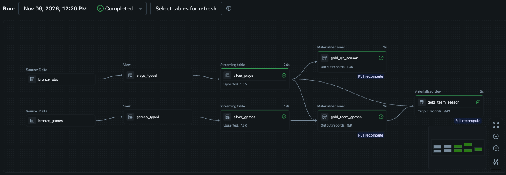
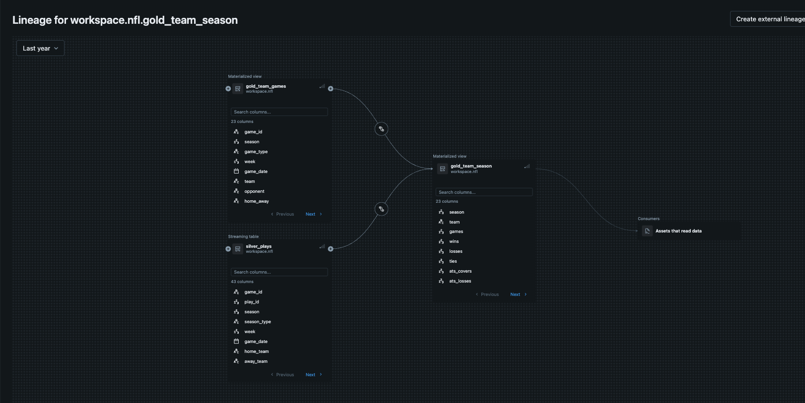

# Sports Lakehouse on Databricks

An incremental NFL analytics lakehouse: 28 seasons of play-by-play (1999 → this week) landed,
deduplicated and modelled into team, game and quarterback efficiency tables, refreshed every
Tuesday after Monday Night Football. Built on Databricks (Unity Catalog, Lakeflow Spark Declarative
Pipelines, Lakeflow Jobs, AI/BI dashboards and Genie), deployed as code with Asset Bundles and
GitHub Actions.



## Architecture



| Layer | Object | Grain | Built by |
|---|---|---|---|
| Landing | `landing` volume | one file per dataset (per season where seasonal) per snapshot | `src/ingest/nfl_ingest.py` |
| Bronze | `bronze_pbp`, `bronze_games`, `bronze_player_week`, `bronze_players`, `bronze_teams` | every row of every snapshot | `src/ingest/nfl_ingest.py` |
| Silver | `silver_plays` | one row per play (latest version) | `src/pipelines/nfl_silver.py` |
| Silver | `silver_games` | one row per game, with closing spread and total, franchise-normalized team codes | `src/pipelines/nfl_silver.py` |
| Silver | `silver_player_week` | one row per player per week: passing, rushing, receiving, defense, kicking, fantasy | `src/pipelines/nfl_silver.py` |
| Silver | `silver_players`, `silver_teams` | dimensions: full names, positions, headshots; team names, conference, division, logos | `src/pipelines/nfl_silver.py` |
| Gold | `gold_team_games` | team × game: margin vs. spread, total vs. over/under, favorite/underdog, EPA/play | `src/pipelines/nfl_gold.sql` |
| Gold | `gold_team_season` | team × season: record, conference/division, EPA ranks, `luck_gap` | `src/pipelines/nfl_gold.sql` |
| Gold | `gold_standings` | team × season (2002+): division rank, games back, approximate playoff seed | `src/pipelines/nfl_gold.sql` |
| Gold | `gold_team_betting` | team × season: ATS overall / as favorite / as underdog / home / away, over-under record | `src/pipelines/nfl_gold.sql` |
| Gold | `gold_qb_season` | QB × season: EPA/dropback, CPOE, full name, headshot | `src/pipelines/nfl_gold.sql` |
| Gold | `gold_player_season` | player × season: box-score totals, EPA, PPR fantasy rank, headshot | `src/pipelines/nfl_gold.sql` |
| Serve | NFL Efficiency dashboard | 3 pages: efficiency (logo scatter, lucky-or-good), player leaders with headshots, betting records | `src/dashboards/nfl_efficiency.lvdash.json` |
| Serve | NFL Efficiency Genie space | natural-language Q&A over gold + plays, with governed definitions and tested example SQL | `genie/`, `scripts/build_genie_space.py` |

## Running on Databricks

The declarative pipeline: bronze sources → typed views with expectations → AUTO CDC streaming tables → gold
materialized views. The first full run upserted 1.3M plays and 7.5K games.



Unity Catalog lineage for `gold_team_season`, captured automatically from the pipeline:



## The GM layer

The second half of the project asks what a general manager needs to improve a roster, then builds it:
where the team is weak, who is worth their contract, how the cap is spread, how well the team drafts,
and what injuries are costing it.

**More sources, one model.** Thirteen more nflverse feeds: OverTheCap contracts, draft picks (2000+),
the combine, snap counts (2013+), official injury reports (2009+), Next Gen Stats (2016+), Pro Football
Reference advanced stats (2018+) and FTN charting (2022+). They use three different player ids (NFL gsis,
PFR, OverTheCap), so `silver_players` carries all of them as the crosswalk. Every source's team codes,
including PFR-style `GNB`/`KAN` and nicknames like "Giants", map to one franchise code.

| GM question | Gold mart |
|---|---|
| Where are we weak? | `gold_team_report_card`: 26 metrics by unit and phase, with direction-aware league rank, percentile and tier |
| Who is worth their contract? | `gold_player_value`: APY vs. production *within position group*, as a value score (bargain to overpaid) |
| How is our money spread? | `gold_cap_allocation`: share of team APY by position group vs. the league and the top-8 teams |
| How good is each player? | `gold_player_advanced`: box score, EPA, snap role, Next Gen Stats, PFR and play-by-play defensive credit |
| How well do we draft? | `gold_draft_pick_value`, `gold_draft_team_grades`, `gold_draft_position_value`: AV vs. the expected value of the pick slot |
| Where do we pick? | `gold_draft_order_projection` |
| What are injuries costing us? | `gold_injury_report`, `gold_team_injury_impact` (starter-games lost) |
| How current is this? | `gold_data_freshness` |

**GM Office dashboard** (`src/dashboards/gm_office.lvdash.json`): Report Card, Roster & Cap,
Personnel, Draft and Health pages behind one dashboard-wide Team picker. League-wide datasets name
their team column `club`, so the picker leaves them whole.

**Specialized Genie agents** (`genie/agents/`): a Team Performance Analyst, a Roster & Cap Strategist,
a Personnel Scout and a Draft & Development agent. Each sees only the tables for its domain, and each
shares one set of accuracy rules: exact names, rank tiers out of 32, "as of week N", and no causes the
data doesn't contain. They come with 22 example queries, each run against the warehouse first.

Decisions worth calling out:
- **Stale sources are caught, not trusted.** The in-season PFR file stopped at week 3, so a $28M edge
  rusher showed 5 pressures. Current-season defensive value now comes from play-by-play credit (sacks,
  QB hits, passes defensed, interceptions per 100 snaps), and `gold_data_freshness` states each source's lag.
- **Don't score what the data can't measure.** No source has individual blocking grades, so offensive
  linemen get no value score instead of a fake one based on snap share.
- **Testing the AI changed the data model.** A Genie answer about "defense" filtered `phase = 'Defense'`
  and missed the pass rush (#31). The report card gained a `unit` column, and the answer is now right.
  Earlier Genie tests similarly moved `luck_gap` into gold and fixed a relocated-franchise join.
- **APY, not cap hit.** OverTheCap's contract file gives average annual value. Every surface labels it
  APY rather than calling it the cap.

## Design decisions

**The source republishes, so land snapshots and let CDC dedupe.** nflverse rewrites the entire
current-season file every night, corrections included. Overwriting one file would lose history,
and appending it again would double-count. Each run lands an immutable, timestamped snapshot. Bronze
is append-only. `silver_plays` uses `AUTO CDC` keyed on `(game_id, play_id)` and ordered by snapshot
time, so a corrected play replaces the old version instead of duplicating it.

**A type contract at the bronze boundary.** Column types drift across seasons (for example,
`goal_to_go` is INT in 2010 and DOUBLE everywhere else), which breaks appends into one Delta
table. Bronze stores every numeric column as DOUBLE and every all-null column as STRING. Silver
applies the real types to the ~40 columns that matter.

**Ingest that fails soft.** Download and load are separate steps. If the download is blocked (Free
Edition restricts outbound traffic), `scripts/land_files.sh` lands the same files from a laptop and
the notebook loads them with `download=false`. The job fails only when there is no new data at all,
so the pipeline never refreshes on top of a silent miss.

**Data quality as code.** Pipeline expectations drop plays with no key or an unknown season type,
and track out-of-range EPA and downs as warnings, visible in the pipeline event log.

**Metrics are defined once, in gold.** Testing the Genie space showed it flipping the sign when it derived
"luck" itself (it called the unluckiest teams the luckiest). `luck_gap` and `record_rank` now live in
`gold_team_season`, and the dashboard and Genie both read the same column. Testing Genie's example SQL
also turned up a join bug: play-by-play uses each franchise's current code for every season (the 1999
Rams are `LA`), while schedules use the historical one (`STL`), so about 50 team-seasons had no record. Silver now
maps both onto one franchise code, and the e2e test checks for it.

**Tested off-platform.** `tests/local_e2e.py` runs the real bronze contract, silver selects and
gold SQL on OSS Spark against real seasons. It checks schema unification across 1999–2026,
latest-snapshot-wins dedup, and that every game lands exactly twice in `gold_team_games` with
mirrored margins.

## Run it

```bash
databricks auth login --host https://<your-workspace>.cloud.databricks.com
databricks bundle deploy
databricks bundle run nfl_weekly_refresh      # current season
```

For the first full backfill, run `src/ingest/nfl_ingest.py` once with `seasons=backfill`, then run
the pipeline. CI (`.github/workflows/deploy.yml`) validates on every PR and deploys on merge to `main`.

## Next steps / known gaps

- Plays that nflverse deletes in a later snapshot stay in silver. The fix is `AUTO CDC FROM SNAPSHOT`.
- NBA module on the same framework (hoopR play-by-play, shots, player box scores), with SCD2
  player-team history across trades.
- Game-outcome model vs. the closing spread (MLflow), using rolling EPA from `gold_team_games` as features.

Data: [nflverse](https://github.com/nflverse/nflverse-data) (CC-BY 4.0).
